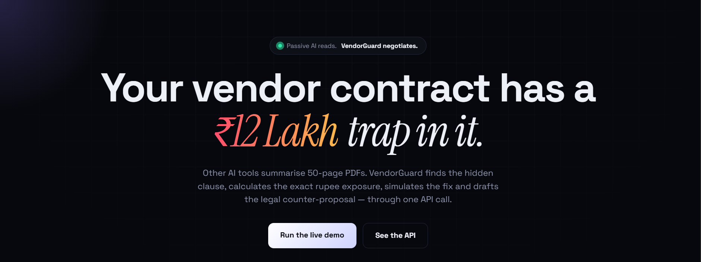
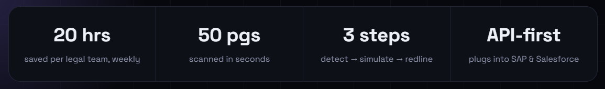
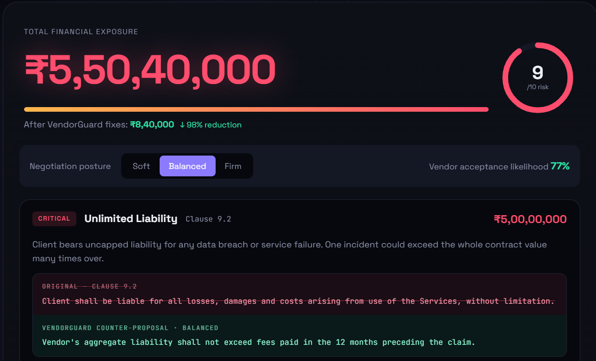
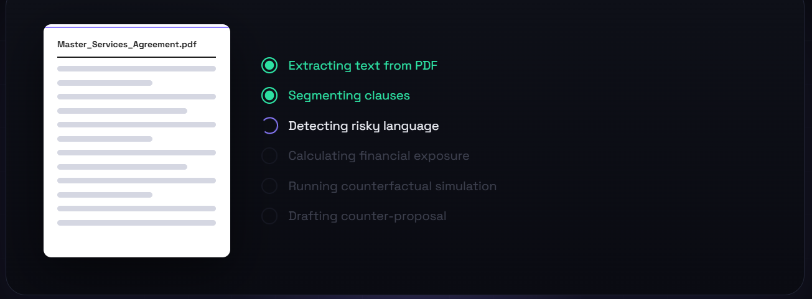

# VendorGuard
FastAPI-powered contract intelligence &amp; counterfactual negotiation engine. Automatically segments PDF clauses, calculates financial liability risk, and generates legal redlines with vendor acceptance probabilities.
Note: the links and images in this document may point to external sources. Please review them before opening.

🛡️ VendorGuard

Passive AI reads. VendorGuard negotiates.

  <b>An API-first Autonomous Counterfactual Negotiator for vendor contracts.</b> 
  Detects hidden clause traps, quantifies exact financial exposure in Rupees (₹), simulates fixes, and writes ready-to-send legal redlines in seconds.

<!-- HERO BANNER IMAGE -->

  

Key Highlights •
Visual Walkthrough •
The 3-Stage Engine •
Tech Stack •
Getting Started •
API Reference •
The Team

⚡ The Problem: Your Vendor Contract Has a Hidden Trap

Most enterprise AI contract tools act as glorified text summarizers: they chew through a 50-page PDF, output generic summaries, and flash an arbitrary Risk Score: 8/10. Your legal and procurement teams are still stuck calculating liability risk by hand and drafting counter-proposals manually.

VendorGuard changes the paradigm:

🎯 Identifies predatory clauses (unlimited liability, silent 3-year auto-renewals, unilateral price hikes).

💰 Quantifies financial exposure in cold, hard numbers (e.g., ₹5,50,40,000 baseline exposure).

🔄 Runs counterfactual simulation to price out alternatives across Soft, Balanced, and Firm negotiation postures.

✍️ Drafts the legal redline with projected vendor acceptance odds, accessible via an interactive UI or a single REST API call.

📸 Visual Walkthrough

All UI assets and screenshots can be placed under the assets/screenshots/ directory.

1. Hero & Real-time Financial Trap Detection

The landing experience features a dynamic dark-mode glassmorphic interface with cursor glow, live statistic trackers, and real-time counter metrics.

  
  
<i>Landing view highlighting weekly hours saved, rupee exposure detection, and API-first readiness.</i>

2. Multi-stage Contract Scanner

Users can drag & drop any vendor PDF/TXT file or launch the built-in Master Services Agreement benchmark. The document scanner executes synchronous text extraction, clause segmentation, and counterfactual analysis.

  
  
<i>Live document scanning animation highlighting text parsing, risk taxonomy, and redline drafting.</i>

3. Dynamic Results Dashboard & Negotiation Posture Switcher

Interactive exposure gauge, risk ring, and posture switcher (Soft vs. Balanced vs. Firm) that recalculates risk exposure and vendor acceptance likelihood on the fly.

  
  
<i>Real-time financial exposure reduction gauge, risk score, and tone posture controls.</i>

4. Clause Findings & Side-by-Side Legal Redline

Each flagged clause shows the exact legal reasoning, original predatory clause, proposed redline replacement, and one-click copy buttons for legal counsel.

  
  
<i>Side-by-side comparison of original vendor language and VendorGuard counter-proposals.</i>

🧠 The 3-Stage Autonomous Engine

       [ Upload Vendor PDF / TXT ]
                   │
                   ▼
┌──────────────────────────────────────────────┐
│  STAGE 01: DETECT                            │
│  • Page-by-page PDF extraction (pypdf/stream)│
│  • Regex & Semantic Legal Taxonomy parsing  │
│  • Clause isolation & severity rating        │
└──────────────────────┬───────────────────────┘
                       │
                       ▼
┌──────────────────────────────────────────────┐
│  STAGE 02: SIMULATE                          │
│  • Counterfactual financial pricing engine   │
│  • Calculates baseline exposure in INR (₹)   │
│  • Simulates liability ceiling adjustments   │
└──────────────────────┬───────────────────────┘
                       │
                       ▼
┌──────────────────────────────────────────────┐
│  STAGE 03: NEGOTIATE                         │
│  • Generates Soft, Balanced & Firm redlines  │
│  • Computes vendor acceptance probabilities   │
│  • Emits structured JSON payload / Redlines  │
└──────────────────────────────────────────────┘

👥 The Team & Credits

VendorGuard was engineered collaboratively by Team Elite-Hackers:

<table>
  <tr>
    <td align="center" width="33%">
        
      <b>Sagarjit</b> 
      Frontend Engineering & UI/UX
        
      

        • Interactive glassmorphism UI & micro-interactions 
        • SVG animated risk gauges & dynamic counter counters 
        • Drag-and-drop file upload & scanning animation
      

    </td>
    <td align="center" width="33%">
        
      <b>Utkarsh</b> 
      Full-Stack Integration & Client Pipeline
        
      

        • Frontend-to-Backend async API handshake 
        • Real-time posture switching & acceptance state sync 
        • Fallback demo pipelines & cross-origin communication
      

    </td>
    <td align="center" width="33%">
        
      <b>Chirag</b> 
      Backend Architecture & Legal Engine
        
      

        • High-throughput FastAPI core & CORS middleware 
        • PDF parsing with PyPDF & zlib decompression 
        • Counterfactual exposure rules & automated redlines
      

    </td>
  </tr>
</table>

🛠️ Tech Stack

Frontend

Semantic HTML5 & Vanilla JavaScript (ES6+): Zero framework bloat, sub-second load times.

Modern CSS3: Custom properties, glassmorphism (backdrop-filter), cursor-following radial glow, dynamic SVG circular gauges, and responsive flex/grid layouts.

Typography: Space Grotesk, JetBrains Mono, and Instrument Serif.

Backend

FastAPI: Asynchronous, typed, high-performance REST API.

Uvicorn: Lightning-fast ASGI web server.

Pydantic v2: Strict schema validation and data serialization.

PyPDF / Stream Decompressor: Robust text extraction supporting varied PDF versions and compressed stream buffers.

🚀 Getting Started

Prerequisites

Python 3.10+ installed

Git

1. Clone the Repository

git clone https://github.com/your-username/VendorGuard.git
cd VendorGuard

2. Set Up a Virtual Environment

# macOS / Linux
python3 -m venv venv
source venv/bin/activate

# Windows
python -m venv venv
venv\Scripts\activate

3. Install Dependencies

pip install fastapi uvicorn pydantic pypdf

4. Run the Application

python main.py

The server will start at http://127.0.0.1:8000.

🌐 Web Interface: Open http://localhost:8000/ in your browser.

📖 Interactive Swagger API Docs: Open http://localhost:8000/docs.

📡 API Reference

Analyze Contract

Extracts clauses, identifies risk exposure, and generates redlines.

POST /analyze

Form Parameters:

Field

Type

Description

file

UploadFile (Optional)

PDF or TXT contract document.

posture

string (Optional)

soft, balanced (default), or firm.

is_sample

boolean (Optional)

If true, runs the built-in Master Services Agreement benchmark.

Example cURL:

curl -X POST "http://localhost:8000/analyze" \
  -F "file=@vendor_msa.pdf" \
  -F "posture=balanced"

Sample Response (200 OK):

{
  "risk_score": 9,
  "total_exposure_inr": 55040000,
  "exposure_after_inr": 825600,
  "findings": [
    {
      "title": "Unlimited Liability",
      "clause": "9.2",
      "severity": "critical",
      "exposure_inr": 50000000,
      "why": "Client bears uncapped liability for any data breach or service failure. One incident could exceed the whole contract value many times over.",
      "original": "Client shall be liable for all losses, damages and costs arising from use of the Services, without limitation.",
      "redlines": {
        "soft": "Each party's aggregate liability shall not exceed three (3) times the fees paid in the 12 months preceding the claim.",
        "balanced": "Vendor's aggregate liability shall not exceed fees paid in the 12 months preceding the claim.",
        "firm": "Vendor's aggregate liability shall not exceed fees paid in the 12 months preceding the claim, excluding claims arising from Vendor's gross negligence, which shall be uncapped."
      },
      "acceptance": {
        "soft": 88,
        "balanced": 72,
        "firm": 46
      }
    }
  ]
}

🎯 Target Integrations

VendorGuard is designed as an API-first microservice that plugs directly into existing enterprise procurement ecosystems:

System

Integration Pattern

Capability

SAP Ariba

Webhook / REST API

Auto-evaluates inbound vendor bids before PO approval.

Salesforce

CRM Middleware

Flags supplier clause discrepancies directly in contract records.

Slack / Teams

Bot / Alerts

Posts instant risk warnings with redline recommendations to #legal-approvals.

Zapier

Trigger / Action

Automatically routes parsed PDFs from Gmail/Dropbox into VendorGuard.

🤝 Contributing

Fork the Project

Create your Feature Branch (git checkout -b feature/AmazingFeature)

Commit your Changes (git commit -m 'Add some AmazingFeature')

Push to the Branch (git push origin feature/AmazingFeature)

Open a Pull Request

  
Built with ❤️ by <b>Team Elite-Hackers</b>

  
<b>Sagarjit</b> (Frontend) • <b>Utkarsh</b> (Integrator) • <b>Chirag</b> (Backend)

  
FastAPI • Legal Risk Engine • Counterfactual Simulation

